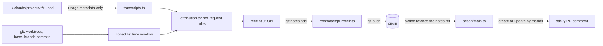

# pr-receipts

**What did this pull request cost?** `pr-receipts` reads the usage metadata Claude Code already writes on your machine, works out which API requests belong to a branch, prices them at list price, stores the result on the branch's commits as a git note, and a GitHub Action posts it on the PR as one sticky comment. It is for people who let coding agents write PRs and want the bill next to the diff.

It never reads out prompts, code, or tool output: only token counts, ids, timestamps, model names, and repo-relative file paths.

## What it looks like

A real receipt, generated on 2026-10-04 on the author's macOS laptop from local transcripts, for six commits on the author's personal site repo ([`examples/agnij-me.receipt.md`](examples/agnij-me.receipt.md), raw JSON alongside it):

> ### PR Receipt
>
> **This PR cost $6.92 and 35 minutes of agent time.**
>
> | | |
> |---|---|
> | Cost (API list price) | **$6.92** |
> | Agent time | 35 minutes |
> | Models | Sonnet 5, Opus 5.5 |
> | Human turns | 17 |
> | API requests | 144 |
> | Retries | 0 API error retries |
> | Tool calls | 302 |
> | Files touched | 2 |
> | Sessions | 2 |
>
> Collapsed below the table: token breakdown by model (cache hit rate 98%), files touched, and how each request was attributed.

The cost is a **lower bound** at **API list prices**. Read [Limitations](#security-model-and-limitations) before quoting a number.

## Why

Agent-written PRs arrive with a diff and a description, but not with what they cost. Claude Code records per-request token usage in `~/.claude/projects`, so the data exists, but it is organized by session and day, while review happens per PR. A session often spans several branches, and several sessions often feed one PR. `pr-receipts` does the join (requests to branch, branch to PR) at push time, while the transcripts still exist, and puts the answer where reviewers already look.

## Quickstart

Requires Node 20+ and git.

```bash
git clone https://github.com/agnij-dutta/pr-receipts.git
cd pr-receipts
npm ci
npm test                 # builds, then runs the test suite on synthetic fixtures
```

Try it without touching your own transcripts, using the synthetic fixture world (a temp git repo plus fake transcripts):

```bash
npm run fixtures         # prints the paths of a generated world under test/fixtures/generated/
W=$(ls -d test/fixtures/generated/world-* | head -n 1)
node dist/src/cli.js collect --repo "$W/repo" --projects-dir "$W/claude/projects" --out receipt.json
node dist/src/cli.js render --in receipt.json
```

Expected `collect` output (captured from a fresh clone):

```
This PR cost $0.31 and 20 minutes of agent time.  (5 requests, confidence high) -> receipt.json
```

On a real repo, after an agent has worked on a branch:

```bash
npm link                      # puts `pr-receipts` on PATH (from the pr-receipts checkout)

cd ~/code/some-repo
git checkout feature/thing    # a branch an agent worked on
pr-receipts collect           # -> receipt.json
pr-receipts render            # -> Markdown on stdout
pr-receipts attach --push     # store as a git note on the branch head, push refs/notes/pr-receipts
pr-receipts install-hook      # or: attach + push automatically on every `git push`
```

Then add the workflow below to that repo.

## GitHub Action

Save as `.github/workflows/pr-receipts.yml` in the repo that receives agent PRs (also in [`examples/workflow.yml`](examples/workflow.yml)):

```yaml
name: PR Receipts

on:
  pull_request:
    types: [opened, synchronize, reopened]

# Least privilege: read the code, write one PR comment. Nothing else.
permissions:
  contents: read
  pull-requests: write

# One run per PR at a time, so two quick pushes can't both create a comment.
concurrency:
  group: pr-receipts-${{ github.event.pull_request.number }}
  cancel-in-progress: true

jobs:
  receipt:
    runs-on: ubuntu-latest
    steps:
      - uses: actions/checkout@v4
        with:
          fetch-depth: 0 # receipts are notes on the PR's commits, so the commits must be here
      - uses: agnij-dutta/pr-receipts@v0
        with:
          dry-run: "false" # "true" prints the comment to the log and step summary, no API calls
          on-missing: skip # or "comment" to post a short "no receipt yet" note
```

What it does, in order:

1. `git ls-remote` checks whether `refs/notes/pr-receipts` exists on `origin`. If it does, it is fetched. If it does not, the run continues (and skips). Any other git failure fails the step, so an auth problem never looks like "no receipt".
2. Finds the newest receipt among the PR's commits (`base..head`, newest first, up to 200 commits). If the head commit is missing from the clone, it fails and tells you to use `fetch-depth: 0`.
3. Renders the comment, writes it to the job's step summary, and sets the outputs.
4. Lists the PR's comments and looks for one whose body **starts with** the hidden marker `<!-- pr-receipts:sticky -->`. If found and identical, it does nothing. If found and different, it PATCHes that comment. Otherwise it POSTs a new one. Re-running the job never creates a second comment.

| Input | Default | Meaning |
|---|---|---|
| `github-token` | `${{ github.token }}` | Token for listing, creating and updating PR comments. Needs `pull-requests: write`. Not used in dry-run. |
| `notes-ref` | `pr-receipts` | Notes ref holding receipts, without the `refs/notes/` prefix. |
| `dry-run` | `false` | `true`: render to the log and step summary and make **zero GitHub API calls**. The notes ref is still fetched over git. |
| `on-missing` | `skip` | `skip`, or `comment` to post a short "no receipt attached yet" note. |

| Output | Meaning |
|---|---|
| `cost-usd` | Total list-price cost from the receipt, when one was found. |
| `headline` | The one-line headline, when one was found. |

The Action is a composite action with no dependencies. It runs the committed `dist/` with the runner's preinstalled `node` (20 or newer), so there is no install or build step in CI.

## Usage

### Commands

| Command | What it does |
|---|---|
| `collect` | Find this branch's requests, aggregate, write `receipt.json` (or `--out`). |
| `render [--in receipt.json] [--sticky]` | Print the Markdown receipt. `--sticky` adds the hidden marker. |
| `attach [--in receipt.json] [--push] [--remote origin]` | Write the receipt as a git note on the branch head (collecting first unless `--in`). `--push` pushes the notes ref. |
| `show [--commit sha] [--branch b] [--base ref] [--json]` | Read back the newest receipt on the branch, or the one on `--commit`. |
| `install-hook` | Add a `pre-push` hook that runs `attach --push` for branches other than `main`/`master`. Never blocks the push. |
| `comment --event event.json [--dry-run]` | Run the Action logic locally against a saved event payload. |
| `--version`, `--help` | |

### Flags

| Flag | Applies to | Default | Meaning |
|---|---|---|---|
| `--repo <path>` | all | cwd | Repository to work in. |
| `--branch <b>` | collect, attach, show | current branch | Branch the receipt is for. |
| `--base <ref>` | collect, show | `origin/HEAD`, then `origin/main`, `main`, `origin/master`, `master` | Base for the `base..branch` commit range. |
| `--since <commit>` | collect | | Start the window at this commit's time instead of the base range. |
| `--from <iso>` | collect | | Override the window start. |
| `--to <iso\|now>` | collect | | Override the window end. |
| `--lookback <min>` | collect | `120` | Minutes before the first commit included in the window. |
| `--tail <min>` | collect | `15` | Minutes after the last commit included in the window. |
| `--loose` | collect | off | Also count sessions launched outside the repo that edited files in it. See [Attribution rules](#attribution-rules). |
| `--include-tools` | collect | off | Add per-tool call counts. Opt-in because MCP tool names reveal which services an agent used. |
| `--no-file-paths` | collect | paths on | Keep only the count of files touched. |
| `--out <file>` | collect | `receipt.json` | Where to write the receipt. |
| `--in <file>` | render, attach | `receipt.json` (render) | Read a receipt instead of collecting. |
| `--push`, `--remote <name>` | attach | `origin` | Push `refs/notes/<notes-ref>` after attaching. |
| `--projects-dir <path>` | collect, attach | `~/.claude/projects` | Where transcripts live. |
| `--pricing <file>` | collect, attach | bundled `config/pricing.json` | Pricing table to use. |
| `--notes-ref <ref>` | attach, show, comment | `pr-receipts` | Notes ref name. |
| `--event <file>`, `--dry-run` | comment | `$GITHUB_EVENT_PATH` | Event payload; render without calling the API. |

### Environment variables

None are required. See [`.env.example`](.env.example).

| Variable | Used by | Meaning |
|---|---|---|
| `CLAUDE_CONFIG_DIR` | collect | Claude Code's config dir. Transcripts are read from `$CLAUDE_CONFIG_DIR/projects` (default `~/.claude/projects`). |
| `PR_RECEIPTS_IN_HOOK` | pre-push hook | Set by the hook around its own `git push` of the notes ref so the hook doesn't re-run. Don't set it yourself. |
| `GITHUB_TOKEN` | comment | Fallback token when `INPUT_GITHUB_TOKEN` is unset. |
| `GITHUB_EVENT_PATH`, `GITHUB_REPOSITORY`, `GITHUB_API_URL`, `GITHUB_WORKSPACE`, `GITHUB_STEP_SUMMARY`, `GITHUB_OUTPUT` | comment, Action | Standard Actions runner variables. |
| `INPUT_GITHUB_TOKEN`, `INPUT_NOTES_REF`, `INPUT_DRY_RUN`, `INPUT_ON_MISSING` | Action | The Action's inputs, as `action.yml` passes them. |

## How it works



Claude Code writes one JSONL file per session, plus `<session>/subagents/*.jsonl` for subagents. Every `assistant` record carries `message.usage` (input, output, `cache_read_input_tokens`, `cache_creation.ephemeral_5m/1h_input_tokens`, `speed`, `server_tool_use`), `message.model`, `timestamp`, `cwd`, `gitBranch`, `sessionId` and `isSidechain`. `system` records carry `turn_duration` (with `durationMs`) and `api_error` (retries).

Claude Code writes one record per streamed content block, so a single API response appears several times with the same `message.id`. The parser deduplicates by `message.id` across all files (which also covers resumed sessions that copy earlier history) and keeps the max of each counter. `<synthetic>` placeholder messages are skipped.

### Time window

1. Commits in `base..branch`. The window runs from the **earliest author or committer time** minus `--lookback` (2h) to the **latest committer time** plus `--tail` (15 min). Author time is used because a rebase rewrites every committer date to the moment of the rebase.
2. `--since <commit>` starts the window at that commit instead. `--from` and `--to` override either end.
3. If the branch has no commits ahead of base (already merged, or nothing committed yet), the window is the span of transcript records that are positively on the branch (rule 1 below).

### Attribution rules

Attribution is per API request, not per session, because one session often spans several branches.

1. **Dedicated worktree.** `cwd` is inside a worktree other than the main checkout (including Claude Code's `.claude/worktrees/*`): it matches if that worktree is on the target branch, and is excluded otherwise. The innermost worktree wins.
2. **Main checkout, branch known.** `cwd` is in the main checkout and the record's `gitBranch` is a real branch: it matches if equal to the target, and is excluded otherwise.
3. **Main checkout, branch unknown.** `gitBranch` is `HEAD` (the session was launched outside git, or detached): it matches on `cwd` plus the time window.
4. **`--loose` only.** A session whose `cwd` is outside the repo, but that edited files (Edit, MultiEdit, Write, NotebookEdit) in the target branch's own checkout during the window, contributes its in-window requests, unless a record's `gitBranch` names a different branch.

The receipt shows how many requests matched by each rule, how many were excluded as other-branch, and a confidence label: `high` when at least 80% matched by branch, `low` when over 20% came from `--loose`, `medium` otherwise.

Why worktree first: Claude Code stamps `gitBranch` from the directory the session was **launched** in. A session started in the main checkout that `cd`s into `.claude/worktrees/foo` stamps every record with the main checkout's branch, so for dedicated worktrees the worktree's own branch is the truth.

### Where attribution can be wrong

Found by running it against real transcripts:

- **Stale branch labels.** In the main checkout, if the agent runs `git checkout other-branch` mid-session, later records can carry the old `gitBranch`.
- **Sessions launched from a parent folder** (e.g. `~/Desktop`) record `gitBranch: "HEAD"` and a `cwd` outside the repo, so they don't match unless `--loose` sees file edits. Bash-driven edits (`sed -i`, `cat >`) are invisible to `--loose`.
- **Parallel work in the main checkout.** Two sessions in the same checkout on `HEAD` during the same window are indistinguishable; both count.
- **Window edges.** Planning more than 2h before the first commit, or work after the last commit plus 15 min, falls outside. Tune with `--lookback`, `--tail`, `--from`, `--to now`.
- **Agent time sums turns.** When Claude Code recorded turn durations, parallel sessions add up rather than overlap. Without turn durations, agent time is estimated from timestamps on a merged timeline, ignoring gaps over 5 minutes.

### Why git notes, not a committed file

CI can't read `~/.claude`, so the receipt has to travel with the push.

| | git notes (`refs/notes/pr-receipts`) | committed `.receipts/<branch>.json` |
|---|---|---|
| PR diff | untouched | an extra JSON file in every PR |
| Merge conflicts | none (one note per commit) | yes, when branches stack |
| Main history | clean | receipts merged into main forever |
| Keyed to | exact commit SHA | branch name (renames break it) |
| CI cost | one `git fetch` of the notes ref | none |
| Fork PRs | notes don't travel with forks | works |
| Squash merge | note stays on the PR's commits; the comment is already posted | file lands on main |

Notes win for the target use case: agents pushing branches to repos you own. The receipt is cumulative for the branch, and the Action uses the newest note among the PR's commits, so commits pushed after the last attach aren't counted until the next attach. Notes are not pushed or fetched by default: `attach --push` pushes the ref and the Action fetches it. If the remote notes ref has moved (another machine attached a receipt), `attach --push` fetches it, merges with the `ours` strategy (our receipt wins on the same commit), and pushes again.

### Why receipts are written at push time

Claude Code deletes transcripts older than `cleanupPeriodDays` (30 days by default). A receipt computed on demand weeks later would silently shrink as transcripts expire. Writing it at push time (by hand with `attach --push`, or with `install-hook`) captures the numbers while they still exist, and the note keeps them after the transcripts are gone.

## Security model and limitations

**The cost is a lower bound.** Claude Code makes side calls that never land in the transcript: session titles, away summaries, the auto-mode permission classifier. On one 81-minute session (measured in October 2026 on the author's laptop), the transcript-derived cost was $12.20 while Claude Code's own `cost-state` record for the same session said $14.45, about 16% under. Refusal fallbacks are priced at the final iteration only. Requests on models missing from the pricing table count as $0, are listed as unpriced, and the headline then says "at least".

**It shows API list prices, not what you paid.** On a Pro or Max subscription this is the API-equivalent cost of the tokens, not your bill. Bedrock, Vertex and negotiated discounts are not modeled.

**Fork PRs are not supported.** A fork contributor's notes are pushed to their fork, not to your repo, and the `pull_request` token for forks is read-only. The Action detects fork PRs and skips them without any API call.

**Privacy.**

- `src/transcripts.ts` is the only code that touches raw transcript lines. It copies out numbers, ids, timestamps, `cwd`/`gitBranch`, tool **names**, and `file_path` from file-editing tools. Prompt text, assistant text, thinking, tool inputs and tool results are never copied, and each parsed record is dropped after its fields are read.
- File paths outside the target branch's checkout are dropped; paths inside it are made repo-relative. Gitignored paths (`.env.local`, build output) are counted but not listed. `--no-file-paths` keeps only the count.
- Per-tool counts are opt-in (`--include-tools`), because MCP tool names reveal which services an agent touched (`mcp__gmail__send_email`).
- Receipts read back from notes or files go through `sanitizeReceipt`, which rebuilds every field from the schema: unknown keys are dropped, numbers are type-checked, strings are single-line and capped, and paths must be repo-relative. A note that is not a valid receipt is an error, not a silent "no receipt". Every rendered string is Markdown-escaped, including leading `@` so a receipt can't ping anyone.
- The tests plant fake secrets in prompts, thinking, tool inputs, tool results, session titles, and a Write to `~/.aws/credentials`, then assert that none of them reach the receipt or the comment.
- `npm run leak-check -- <receipt.json> <receipt.md>` re-reads the sessions a receipt names and checks that no 24-character window of any content string appears in the output. It prints counts only. The committed example passes: 2,249 strings checked, 0 found (run 2026-10-04).

**What it does not protect against.** Anyone who can push to `refs/notes/pr-receipts` can write a receipt with any numbers in it; the sanitizer limits what a note can render, not whether its numbers are true. Receipts are a reporting aid, not an audit trail. Repo-relative paths of files the agent touched are visible on the PR unless you pass `--no-file-paths`. Short session ids (8 characters) and branch names are included.

See [SECURITY.md](SECURITY.md) for how to report a privacy or security issue.

## Pricing

[`config/pricing.json`](config/pricing.json) is a table, not truth: per-model input, 5-minute and 1-hour cache writes, cache reads, output, and fast mode, with the source URL and fetch date (2026-10-04) printed on every receipt. Modeled: each cache tier at its own rate, per-model cache-read multipliers (0.1x standard, 0.05x Opus 5.5, 0.025x Fable 5.1), fast mode with cache rates scaled by the same ratio, `inference_geo: "us"` at 1.1x, and web search at $10 per 1,000. Model ids are normalized across the first-party API, Bedrock (`eu.anthropic.claude-...-v1:0`) and Vertex (`claude-...@date`) forms. Unknown models are reported as unpriced, never guessed. The table is validated on load. Override it with `--pricing <file>`.

## Prior art

- [ccusage](https://github.com/ryoppippi/ccusage) is the standard tool for reading these same JSONL files: daily, monthly, per-session and 5-hour-block reports. It answers "what did I spend this week?". `pr-receipts` answers "what did **this PR** cost?" by joining requests to a branch through worktrees, `gitBranch`, `cwd` and the commit window, with exclusions and a confidence label.
- Claude Code's own [`/cost` command and OpenTelemetry metrics](https://docs.anthropic.com/en/docs/claude-code/costs) report cost per session or per organization. They don't know which PR a request served, and they stay on your machine or in your telemetry backend.
- [git notes](https://git-scm.com/docs/git-notes) are how the receipt travels with the commits without changing them, the same mechanism used for code review metadata by tools like Gerrit.

What this adds: per-PR attribution, storage on the commits so CI can use it without access to your machine, and an idempotent sticky comment on the PR.

## Roadmap

- Other agent CLIs (Codex, Gemini CLI, opencode) behind a transcript-adapter interface.
- Attribute Bash-driven file edits for `--loose` by diffing the working tree around tool calls.
- Capture side calls that never reach the transcript (for example via Claude Code's OpenTelemetry export) so the cost stops being a lower bound.
- Fork PR support. A fork cannot push notes to the base repo, so this needs another channel, such as a receipt the contributor uploads as a workflow artifact.
- Publish to npm and the GitHub Marketplace, with a `v0` tag for the Action.

## Contributing

See [CONTRIBUTING.md](CONTRIBUTING.md). Changes are listed in [CHANGELOG.md](CHANGELOG.md).

## License

MIT, see [LICENSE](LICENSE).

## Author

Agnij Dutta, [@0xholmesdev](https://x.com/0xholmesdev) on X, [agnij-dutta](https://github.com/agnij-dutta) on GitHub.
